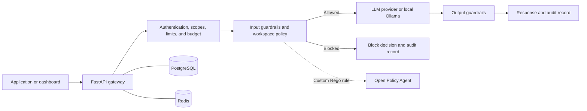

# LLM Guardrail

A safety gateway for LLM requests and agent instructions. Route model traffic
through configurable input and output checks, review blocked requests, and scan
skills before agents load them.

The platform combines a **FastAPI API**, a **React dashboard**, **PostgreSQL**
storage, and **Redis** rate limiting. It supports hosted model providers and
self-hosted Ollama inference.

[Live demo](https://llm-guardrail.onrender.com) ·
[Quickstart](#quickstart-with-docker) ·
[Local development](#local-development) ·
[API guide](docs/API_GUIDE.md) ·
[Private self-hosting](docs/PRIVATE_SELF_HOSTING.md)


*The actual web app rendered locally with synthetic test data. More views and
capture instructions are in the [screenshot guide](docs/SCREENSHOTS.md).*

## What it does

| Area | Capabilities |
| --- | --- |
| LLM gateway | REST, OpenAI-compatible chat, and SSE streaming; provider routing, failover, and circuit breakers |
| Input and output checks | Credential detection, configurable PII handling, injection and jailbreak checks, output rules, and custom OPA/Rego policies |
| Skill Guard | Scan instruction files; manage drafts and versions; review exact findings before distribution |
| Workspace management | Organization policies, scoped gateway keys, teams, request limits, and optional token billing |
| Observability | Request logs, blocked-rule analytics, provider usage, health checks, exports, and signed webhooks |
| Agent integrations | MCP tools, client SDKs, a canonical Python scanner, and a Git pre-push gate |

The scanner uses heuristic checks. Its verdict is evidence for review, not a
guarantee that arbitrary instructions are safe. An integrating agent must honor
the scan decision before loading content.

New to the app? Open **Help & getting started** in the sidebar for an introduction,
examples, and a glossary. The **? Help** button explains the current page and
suggests a useful next step. The sign-in page also has a **What is this?** introduction.

## How it works



1. Authenticate the session or gateway key and resolve its workspace and scopes.
2. Apply request limits, payload limits, and token-budget checks.
3. Evaluate the prompt against the workspace policy. Depending on the rule and
   mode, block, redact, warn, or continue.
4. Route allowed input to the selected provider, with configured failover.
5. Evaluate the output, record the decision and usage, and return the result.

Standard streaming can emit tokens before the final output verdict. Private
mode buffers output until checks pass. See [private self-hosting](docs/PRIVATE_SELF_HOSTING.md)
for its inference, network, and audit boundaries.

Skill delivery follows a separate path: **draft → scan → review any blocked
findings → authenticated download or live fetch**. Saving a draft does not
approve its distribution. Hosted approvals bind the reviewed user, workspace,
content, and delivery revision; external agents still control their own runtime.
See the [skill logic contract](docs/SKILL_LOGIC.md).

## Quickstart with Docker

Requires Docker Engine or Docker Desktop with Compose v2 and Linux containers.

```bash
git clone https://github.com/NghiemNgocDuc/LLM-Guardrail.git
cd LLM-Guardrail
cp .env.example .env
```

On PowerShell, use `Copy-Item .env.example .env` for the last step. Edit `.env`
and set the following values. Use a different random value for each secret;
hexadecimal passwords avoid connection-URL escaping issues.

```env
SECRET_KEY=<at-least-32-random-characters>
POSTGRES_PASSWORD=<random-hex-password>
REDIS_PASSWORD=<different-random-hex-password>
DEFAULT_LLM_BACKEND=mock
DEFAULT_MODEL=mock-local
BILLING_ENABLED=false
```

`mock` exercises the UI and gateway without a model API key. The development
override supplies the local URLs and enables API documentation. Start the six
core services:

```bash
docker compose -f docker-compose.yml -f docker-compose.dev.yml up -d --build db redis opa mandate-gateway api web
```

| Endpoint | Address |
| --- | --- |
| Dashboard | [localhost:8080](http://localhost:8080) |
| Interactive API docs | [localhost:8080/docs](http://localhost:8080/docs) |
| Health check | [localhost:8080/health](http://localhost:8080/health) |

Create an account from the dashboard, open the LLM Playground, and send a
prompt. The API container runs migrations before starting. Data persists in
Docker volumes across restarts.

To use a real model, set its backend, model, and credentials in `.env`, then
recreate `api`. Supported backends are `groq`, `openai`, `anthropic`, `gemini`,
`xai` / `grok`, `ollama`, `openai_compatible`, and optional `litellm`.
The [configuration guide](docs/CONFIGURATION.md) lists the required variables.
For Ollama, its URL must be reachable **from the API container**; container
`localhost` is the container itself.

The full Compose file also includes a Phoenix live feed, a gRPC input checker,
and Watchtower. The live feed needs a separate `SECRET_KEY_BASE` of at least 64
characters. See [operations](OPERATIONS.md) before enabling companion services.

For public hosting, configure HTTPS, production secrets, explicit origins,
PostgreSQL, and Redis, and use the production Compose configuration without the
development override. Production disables `/docs`, `/redoc`, and `/openapi.json`.
Follow [deployment](DEPLOYMENT.md) or [private self-hosting](docs/PRIVATE_SELF_HOSTING.md).

## Local development

Use **Python 3.12**, **Node.js 22**, and a reachable **PostgreSQL** database.
Redis is optional in development; an empty Redis URL uses in-memory limits.

```bash
python -m venv .venv
source .venv/bin/activate
python -m pip install -r requirements-dev.txt
cp .env.example .env
```

On PowerShell, activate with `.\.venv\Scripts\Activate.ps1` and copy the file
with `Copy-Item`. Set these values in `.env`:

```env
APP_ENV=development
DEBUG=true
SECRET_KEY=<local-random-secret>
DATABASE_URL=postgresql+asyncpg://<user>:<password>@localhost:5432/<database>
RATE_LIMIT_REDIS_URL=
PUBLIC_APP_URL=http://localhost:5173
ALLOWED_ORIGINS=http://localhost:5173
DEFAULT_LLM_BACKEND=mock
DEFAULT_MODEL=mock-local
BILLING_ENABLED=false
```

Run the API and frontend in separate terminals:

```bash
python -m uvicorn main:app --reload
```

```bash
npm ci
npm run dev
```

Open [localhost:5173](http://localhost:5173). The frontend defaults to the API at
`http://localhost:8000` in development; override it with `VITE_API_BASE_URL` if
needed. Development startup creates tables. Deployment uses Alembic migrations.
The standard Compose database has no published host port, so a host-run API
needs its own reachable database or an explicit local port mapping.

Linux users can alternatively enter the [Nix development shell](flake.nix)
with `nix develop`. Its first run creates `.venv`; commit the generated
`flake.lock` if adopting that workflow.

## Use the API

In the dashboard, open **API keys** and create a gateway key with the `chat`
scope. Use that key for application calls:

```bash
curl http://localhost:8080/chat \
  -H "X-Api-Key: <gateway-api-key>" \
  -H "Content-Type: application/json" \
  -d '{"prompt":"Explain how input guardrails work."}'
```

The response includes the request status, input and output verdicts, model,
latency, and usage information. Provider credentials belong in server-side
environment variables. Gateway keys and provider keys serve different purposes.

Use `POST /skills/scan` with a signed-in Bearer session to scan a skill, and
check `blocked` and `agent_may_continue` before loading it. The raw `safe` field
does not account for explicit server approvals. See the [API guide](docs/API_GUIDE.md)
for signup, authentication, MCP tools, webhooks, and worked examples, or
[SDK.md](SDK.md) for Python, JavaScript, Kotlin, and Swift clients.

## Checks and tests

Run backend tests in the development environment above. The suite uses isolated
fixtures; optional database and language-tool integrations skip when their
prerequisites are unavailable.

```bash
python -m ruff check app guardrails main.py seed.py grpc_gateway/server.py sdk/python examples scripts
python scripts/check_repository_secrets.py
python -m pytest -q
npm run typecheck
npm run build
npx playwright install chromium
npm run test:frontend
npm run test:frontend:private
```

Browser tests build and serve production assets, covering desktop and mobile
layouts, both themes, accessibility, and fixture-backed workflows. They do not
require a running API. Test bundles go to ignored `dist-test/` and `dist-private/`
directories. Stop development servers on ports 5173 and 5175 before running.
On Windows, set `$env:PW_CHANNEL="msedge"` to use installed Edge. Screenshots and failure
traces go to ignored `test-results/`.

The optional [Rust engine](guardrail_core/Cargo.toml) accelerates regex checks.
Without a compiled extension, checks fall back to Python. Build instructions,
golden verdict tests, and additional configuration are in the
[configuration guide](docs/CONFIGURATION.md).

Install the canonical skill scan before pushing:

```bash
./scripts/install-git-hooks.sh
python scripts/scan_agent_skills.py
```

On PowerShell, install with `.\scripts\install-git-hooks.ps1`. The hook checks
committed skill content throughout outgoing history. See the
[hook guide](.githooks/README.md); the Go companion does not replace this gate.

## Repository map

| Path | Purpose |
| --- | --- |
| `main.py`, `app/` | FastAPI entrypoint, routes, auth, services, models, and middleware |
| `guardrails/`, `guardrail_core/` | Python checks and optional Rust acceleration |
| `src/` | React dashboard, components, styles, and API types |
| `alembic/` | PostgreSQL schema migrations |
| `tests/`, `fixtures/` | Backend regressions, browser tests, and scanner fixtures |
| `sdk/`, `examples/` | Client libraries and usage examples |
| `scripts/`, `.githooks/` | Scanning, Git checks, operations, and maintenance |
| `middleware/mandateflow/` | Go capability and provenance sidecar |
| `grpc_gateway/`, `elixir/live_feed/` | Input-check service and realtime audit feed |
| `cli/`, `zig/`, `haskell/`, `julia/` | Companion scanner, environment checker, Rego linting, and analytics |
| `terraform/`, `deploy/` | Infrastructure and deployment configuration |

## Documentation

- [API and agent integrations](docs/API_GUIDE.md) · [SDKs](SDK.md) · [Skill logic](docs/SKILL_LOGIC.md)
- [Configuration, providers, and billing](docs/CONFIGURATION.md)
- [Deployment](DEPLOYMENT.md) · [Render](DEPLOYMENT_RENDER.md) · [Terraform](terraform/README.md)
- [Private self-hosting](docs/PRIVATE_SELF_HOSTING.md) · [Cloud Run review](docs/CLOUD_RUN_PLAN.md)
- [Operations, backups, and uptime monitoring](OPERATIONS.md) · [Live demo setup](LIVE_DEMO.md)
- [Security policy](SECURITY.md) · [Hardening](docs/SECURITY_HARDENING.md)
- [Frontend design](docs/FRONTEND_DESIGN.md) · [Screenshots](docs/SCREENSHOTS.md)
